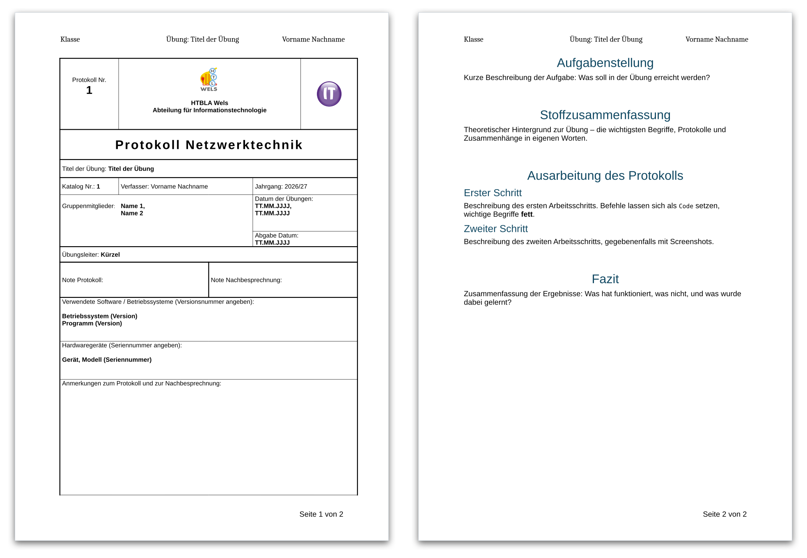

<div align="center">

# Protokoll-Vorlage für Typst

[](https://typst.app)
[](#)
[](#)
[](fonts/Caladea-OFL.txt)

**Die Word-Vorlage „Protokoll Netzwerktechnik“ der HTBLA Wels (Abteilung für
Informationstechnologie) – originalgetreu in [Typst](https://typst.app) nachgebaut.**

Deckblatt, Kopf- und Fußzeile, Überschriften und Fließtext entsprechen dem
Word-Original bis auf Bruchteile eines Punkts. Ausfüllen, kompilieren, abgeben –
ohne Word, ohne verrutschte Tabellen.



[Schnellstart](#schnellstart) •
[Felder](#felder) •
[Folgeseiten](#folgeseiten) •
[Schriften](#schriften) •
[Genauigkeit](#wie-genau-ist-der-nachbau)

</div>

---

## Features

- **Deckblatt wie im Original:** alle Rahmen, Zellen und Logos an derselben Stelle
- **Maße direkt aus dem Word-XML:** Spaltenbreiten, Zeilenhöhen, Rahmenstärken, Tabstopps
- **Felder wachsen mit:** mehr Gruppenmitglieder oder Software-Zeilen machen die Zeile höher,
  „Anmerkungen“ füllt den Rest der Seite
- **Freie Ersatzschriften:** sieht auch ohne Microsoft-Schriften korrekt aus
- **Eine Datei, ein Aufruf:** `#show: protokoll.with(...)` und los

## Schnellstart

```sh
./scripts/fetch-aptos.sh            # einmalig: Schrift Aptos laden (optional, siehe unten)
cp main.typ mein-protokoll.typ      # Werte darin anpassen
typst compile --font-path fonts mein-protokoll.typ
```

Eine Protokoll-Datei sieht so aus:

```typst
#import "protokoll.typ": protokoll, leerzeile

#show: protokoll.with(
  nr: 1,
  titel: "Titel der Übung",
  katalog-nr: 1,
  verfasser: "Vorname Nachname",
  jahrgang: "2026/27",
  klasse: "Klasse",
  gruppenmitglieder: ("Name 1,", "Name 2"),
  uebungsdaten: ("TT.MM.JJJJ,", "TT.MM.JJJJ"),
  abgabe-datum: "TT.MM.JJJJ",
  uebungsleiter: "Kürzel",
  software: ("Betriebssystem (Version)", "Programm (Version)"),
  hardware: "Gerät, Modell (Seriennummer)",
)

= Aufgabenstellung
Text …
```

> [!TIP]
> Liegt die Protokoll-Datei in einem Unterordner, braucht Typst `--root .`,
> damit es auf `protokoll.typ` zugreifen darf:
>
> ```sh
> typst compile --root . --font-path fonts unterordner/protokoll.typ
> ```

## Felder

Alle Felder sind optional – was fehlt, bleibt (wie im Word-Deckblatt) leer.
Fett/normal entspricht dem ausgefüllten Original.

| Feld                   | Im Deckblatt                              | Darstellung               |
| ---------------------- | ----------------------------------------- | ------------------------- |
| `nr`                   | Protokoll Nr.                             | 18 pt fett                |
| `fach`                 | „Protokoll *Netzwerktechnik*“             | Standard: Netzwerktechnik |
| `titel`                | Titel der Übung (auch Kopfzeile Mitte)    | fett                      |
| `katalog-nr`           | Katalog Nr.                               | fett                      |
| `verfasser`            | Verfasser (auch Kopfzeile rechts)         | normal                    |
| `jahrgang`             | Jahrgang                                  | normal                    |
| `klasse`               | Kopfzeile links                           |                           |
| `gruppenmitglieder`    | Gruppenmitglieder – Liste, je eine Zeile  | fett                      |
| `uebungsdaten`         | Datum der Übungen – Liste, je eine Zeile  | fett                      |
| `abgabe-datum`         | Abgabe Datum                              | fett                      |
| `uebungsleiter`        | Übungsleiter                              | fett                      |
| `note-protokoll`       | Note Protokoll                            | fett                      |
| `note-nachbesprechung` | Note Nachbesprechnung                     | fett                      |
| `software`             | Verwendete Software / Betriebssysteme     | fett, je eine Zeile       |
| `hardware`             | Hardwaregeräte                            | fett, je eine Zeile       |
| `anmerkungen`          | Anmerkungen (beliebiger Inhalt)           |                           |
| `kopfzeile`            | `(links, mitte, rechts)` – überschreibt die Kopfzeile | Standard: `(klasse, "Übung: " + titel, verfasser)` |

Listen dürfen auch ein einzelner String sein. Statt Strings geht überall auch
Typst-Inhalt, z. B. `verfasser: [*Vorname* Nachname]`.

## Folgeseiten

| Typst          | Word-Formatvorlage   | Aussehen                                                        |
| -------------- | -------------------- | --------------------------------------------------------------- |
| `= …`          | Überschrift 1        | Aptos Display 20 pt, Blau `#0F4761`, zentriert, 18 pt / 4 pt    |
| `== …`         | Überschrift 2        | Aptos Display 16 pt, linksbündig                                |
| `=== …`        | Überschrift 3        | Aptos 14 pt, linksbündig                                        |
| `==== …`       | Überschrift 4        | Aptos 12 pt kursiv, linksbündig                                 |
| Fließtext      | Standard             | Aptos 12 pt, Zeilenabstand mehrfach 1,158, 8 pt danach          |
| `#leerzeile()` | leerer Absatz        | wie im Original zwischen den Abschnitten                        |

Kopfzeile: Cambria 12 pt mit Tabstopps bei 8 cm (zentriert) und 16 cm (rechts).
Fußzeile: „Seite X von Y“ rechts – auf jeder Seite inkl. Deckblatt, wie im Original.

## Schriften

| Word    | verwendet                                              | Herkunft                                   |
| ------- | ------------------------------------------------------ | ------------------------------------------ |
| Arial   | Arial, sonst **Liberation Sans** (metrisch identisch)  | System (`ttf-liberation`)                  |
| Cambria | Cambria, sonst **Caladea** (metrisch identisch)        | `fonts/` (OFL, im Repo)                    |
| Aptos   | **Aptos**, sonst Liberation Sans                       | `scripts/fetch-aptos.sh` (nicht im Repo – Lizenz) |

> [!NOTE]
> Typst meldet `unknown font family: arial / cambria`, wenn die Microsoft-Schrift
> nicht installiert ist. Das ist harmlos – dann greift die Ersatzschrift.

## Wie genau ist der Nachbau?

Alle Maße stammen direkt aus dem Word-XML (Spaltenbreiten, Zeilenhöhen,
Rahmen 1,5 pt / 0,5 pt, Zellabstände, Tabstopps, Kopf-/Fußzeilenabstand).
Verglichen wurde gegen eine LibreOffice-Darstellung des Originals mit den
echten Schriften (Aptos, Caladea, Liberation Sans):

- **Deckblatt:** alle Rahmenlinien deckungsgleich, Texte innerhalb 0,6 pt
- **Folgeseiten:** identische Zeilenumbrüche, Texte innerhalb 0,2 pt

Bewusste Abweichung: LibreOffice zeichnet im Original eine senkrechte Linie quer
durch „Protokoll Netzwerktechnik“ und „Titel der Übung“ (Darstellungsfehler bei
verbundenen Zellen) – Word tut das nicht, diese Vorlage auch nicht.

## Aufbau

```
.
├── protokoll.typ                  # die Vorlage
├── main.typ                       # Startdatei für ein neues Protokoll
├── assets/                        # Logos für das Deckblatt
├── fonts/                         # Caladea (Ersatz für Cambria, OFL)
├── original/
│   └── Protokoll_Deckblatt.docx   # leeres Word-Original als Referenz
├── scripts/
│   └── fetch-aptos.sh             # lädt Aptos von Microsoft nach fonts/aptos/
└── docs/
    └── vorschau.png               # Bild oben in dieser README
```
